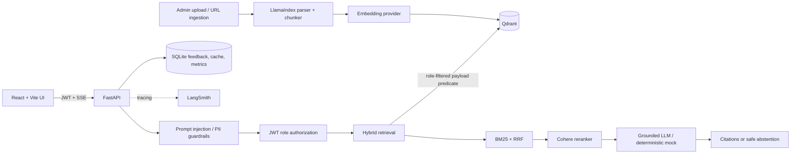

# GENAI-01 — Enterprise RAG Knowledge Platform

An enterprise knowledge assistant that answers questions across financial filings, internal policy documents, and official technical documentation. The platform combines role-filtered Qdrant dense retrieval, BM25 keyword search, Reciprocal Rank Fusion, optional Cohere reranking, grounded generation, deterministic abstention, and query-level cost/latency telemetry.

## Architecture



## Quick start

```bash
cp .env.example .env
# Set JWT_SECRET to a unique random value before exposing the service.
docker compose up --build -d
```

Open the React UI at `http://localhost:5173` and Swagger at `http://localhost:8000/docs`. The default local profile is key-free: deterministic hash embeddings, an extractive mock generator, in-memory-free Qdrant persistence, and optional reranking fallback. It is intended for reproducible evaluation and reviewer walkthroughs, not semantic-quality production traffic.

To run frontend development mode rather than its Nginx container:

```bash
docker compose up -d qdrant api
cd frontend
npm install && npm run dev
```

See [backend/README.md](backend/README.md) and [frontend/README.md](frontend/README.md) for provider setup, data population, security notes, API contracts, and test commands.

## Validation

```bash
python -m pip install -r backend/requirements.txt
pytest -q
cd frontend
npm install && npm run typecheck && npm run build
```

The backend tests are designed to run without paid API keys, Qdrant, Cohere, or LangSmith. Live providers are enabled through backend-only environment variables. The frontend build is a separate TypeScript/Vite validation step.


## Architecture and deployment documentation

- [System architecture and query sequence](docs/ARCHITECTURE.md)
- [HTTP API reference](docs/API_REFERENCE.md)
- [Operations, configuration, and verification](docs/OPERATIONS.md)
- [Monorepo deployment guide](../docs/DEPLOYMENT_GUIDE.md)
- [Release ownership and publication gate](../docs/RELEASE_GOVERNANCE.md)
