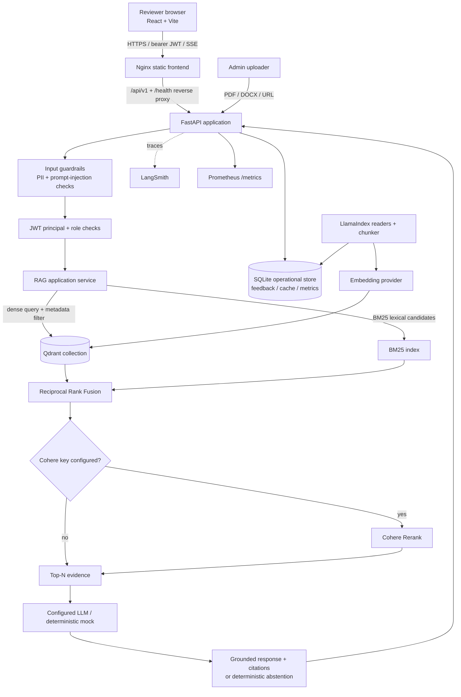
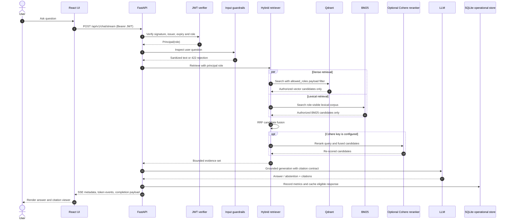

# GENAI-01 — Architecture and Design

## 1. System context

GENAI-01 is a retrieval-augmented knowledge assistant for mixed enterprise documents. The system ingests PDF, DOCX, and allowlisted web content; parses and chunks source material; stores dense vectors and source/authorization metadata in Qdrant; combines vector and BM25 rankings with Reciprocal Rank Fusion (RRF); optionally reranks candidates with Cohere; and generates an evidence-grounded answer or a deterministic abstention.

The current application separates the React client, FastAPI orchestration/API layer, vector store, and a small SQLite operational store for document inventory, feedback, query metrics, and the role-scoped semantic cache.

## 2. Container / runtime architecture

## 3. Query sequence and authorization boundary

**Security invariant:** the role-derived `allowed_roles` predicate must be attached to the Qdrant search itself, before candidate data is returned to the application. Filtering only after retrieval is not an acceptable substitute. The lexical corpus must apply the same authorization rule. The UI role selector is not an authorization boundary; the backend JWT principal is.

## 4. Ingestion, chunking, and retrieval

1. **Input adapters:** LlamaIndex readers parse PDF, DOCX, and configured web URLs. The source record carries `source`, `doc_type`, `page` when available, `allowed_roles`, and ingestion timestamp metadata.
2. **Hierarchical chunking:** split long source material into parent sections and smaller child retrieval units. Parent metadata preserves section/document context while child units optimize matching and keep prompt context bounded. Avoid splitting tables, headings, and numbered clauses where parser output allows reliable structure detection.
3. **Embedding:** selected provider emits fixed-width vectors. The Qdrant collection dimension must match `VECTOR_SIZE`; a provider/dimension change requires a compatible collection migration or a newly named collection and re-ingestion.
4. **Dense retrieval:** Qdrant search applies role filters directly to payload metadata.
5. **Lexical retrieval:** BM25 retrieves exact terms, identifiers, section numbers, and uncommon names; it must operate only over the same role-visible corpus.
6. **Fusion:** RRF combines rank positions rather than treating heterogeneous raw scores as directly comparable.
7. **Reranking:** Cohere reranking is optional and degrades to the fused ranking when no key is configured or the provider is unavailable, as implemented by the current adapter.
8. **Generation:** the prompt requires evidence-backed citations and the exact abstention string when evidence is absent or below the configured threshold.

## 5. Main runtime dependencies and trust boundaries

| Component | Responsibility | Trust boundary / control |
|---|---|---|
| React + Nginx | Chat, citation viewer, feedback, admin upload | Browser is untrusted; never trust client role or hidden controls |
| FastAPI | Authentication, validation, orchestration, SSE | Enforce JWT and admin role server-side; limit request and upload sizes |
| Guardrails | Injection/PII checks | Reject unsafe inputs or redact unsafe feedback comments |
| Qdrant | Dense vectors and authorization metadata | Server-only API key; role predicate applied in the search request |
| BM25 | Exact lexical match | Apply same role visibility as dense retrieval |
| Cohere / LLM APIs | Reranking and generation | Send minimum necessary text; provider calls can incur cost |
| SQLite | Feedback, query metrics, cache and document inventory | Local file persistence only; current implementation is not a managed-Postgres adapter |
| LangSmith | Optional trace capture | Keep API key server-side; redact PII and sensitive document content before tracing |

## 6. Runtime diagrams and endpoints

- OpenAPI: `/openapi.json`
- Swagger UI: `/docs`
- ReDoc: `/redoc`
- Health: `/health`
- Prometheus metrics: `/metrics`
- API prefix: `/api/v1`

See [API_REFERENCE.md](API_REFERENCE.md) for the route contract and [OPERATIONS.md](OPERATIONS.md) for setup, testing, and operational risks.

## 7. Known implementation boundaries

- The SQLite operational store is intentional for a key-free local reviewer path. It does not become durable on a host with an ephemeral filesystem. Use a persistent disk or implement and test a PostgreSQL repository adapter before treating operational records as durable in cloud hosting.
- The current demo-token endpoint is a role-switching demonstration, not enterprise identity. The production configuration correctly disallows demo-token issuance, but a full identity provider / user provisioning path must be added before enabling production mode for ordinary users.
- The frontend streams an already-computed answer in SSE token-sized pieces; it is a streaming transport/UI experience, not token-by-token upstream model streaming.
- Hash embeddings and mock generation are deterministic smoke-test modes, not semantic-quality production inference.
