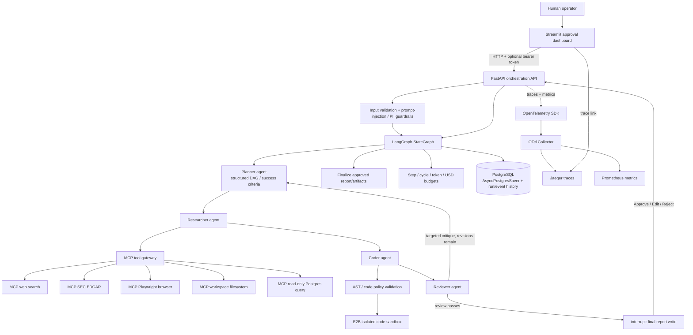
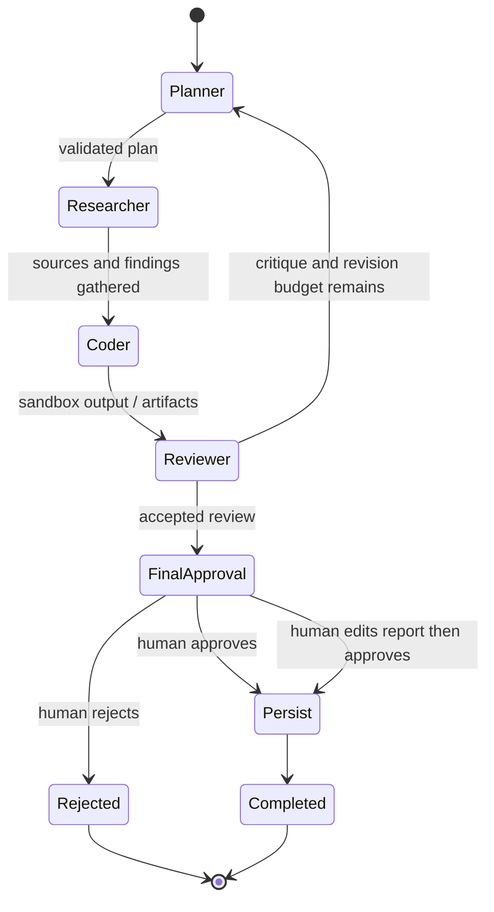

# GENAI-02 — Architecture and Design

## 1. System context

GENAI-02 is a bounded research-and-analysis workflow. A typed LangGraph state machine coordinates four agents—Planner, Researcher, Coder, and Reviewer—using explicit transitions, bounded revisions, run budgets, and durable checkpoints. Research tools are exposed through MCP server modules; generated Python is dispatched to E2B when enabled; PostgreSQL stores graph checkpoints and run/event history; OpenTelemetry provides distributed traces and metrics; and a Streamlit operator dashboard handles review and approval.

The application is an assistive research system. It does not provide investment advice and does not execute real email dispatch, monetary spend, or third-party mutation actions. Such actions are represented as simulated records and require a human approval checkpoint.

## 2. Runtime architecture

## 3. Agent workflow and conditional routing

The implementation persists LangGraph state by `thread_id`. The API rejects creation when a thread identifier already exists; resume/approval operates on the existing thread. The state tracks run ID, thread ID, plan, findings, code, artifacts, review result, current step, step count, revision count, token estimate, cost estimate, guardrail events, errors, and report text/path.

## 4. Human-in-the-loop boundaries

Two approval concepts must be distinguished:

1. **Simulated risky actions:** when the user explicitly requests simulation of spend/email-like actions, the workflow creates an interrupt before any such action is represented. Approval resumes the graph but only confirms the simulated operation; no email is sent and no funds are moved.
2. **Final persistence:** after review, the workflow pauses before writing the reviewed report/artifacts to the managed workspace. The operator can approve, edit the report, or reject. The graph resumes from the durable checkpoint rather than re-running earlier agent nodes.

No auto-approval secret or hidden bypass is used by the UI.

## 5. Tool and sandbox architecture

| Capability | Module family | Scope / safety rule |
|---|---|---|
| Public web search | `mcp_servers/web_search_server.py`, `search_service.py` | Search results are discovery leads; claims need primary-source verification |
| SEC EDGAR | `mcp_servers/sec_server.py`, `sec_service.py` | Public filing/company facts with a descriptive User-Agent |
| Workspace files | `mcp_servers/filesystem_server.py`, `filesystem_service.py` | Paths are contained under configured workspace and file sizes are bounded |
| PostgreSQL reads | `mcp_servers/postgres_server.py`, `postgres_service.py` | Read-only query policy; bounded query/result size; credentials remain server-side |
| Browser automation | `mcp_servers/playwright_server.py`, `browser_service.py` | Domain allowlist, navigation timeout, bounded content extraction |
| Code execution | `sandbox/runner.py` | AST validation precedes remote E2B execution; strict execution/request timeouts; mock mode does not execute on host |

The graph's tool gateway is the central point for MCP lifecycle and per-call boundaries. Do not add a new tool without documenting its schema, authorization scope, network policy, output-size cap, timeout, telemetry attributes, and tests.

## 6. Persistence and observability

- `AsyncPostgresSaver` is the LangGraph checkpoint backend when `PERSISTENCE_ENABLED=true` and the PostgreSQL checkpoint dependency is installed.
- `RunStore` writes `agent_runs` and `agent_run_events` using `asyncpg`.
- The run store is operational history; the LangGraph checkpoint is the graph resume source of truth.
- OpenTelemetry instrumentation emits spans/metrics to OTLP. Local Compose routes OTLP through the Collector to Jaeger and Prometheus.
- Do not expose Jaeger, Prometheus, or the Collector publicly without authentication and ingress restrictions.

## 7. API endpoints

- Health: `/api/v1/health`
- Start run: `POST /api/v1/runs`
- List runs: `GET /api/v1/runs`
- Read run: `GET /api/v1/runs/{run_id}`
- Read events: `GET /api/v1/runs/{run_id}/events`
- Read thread: `GET /api/v1/threads/{thread_id}`
- Approve / Edit / Reject: `POST /api/v1/threads/{thread_id}/approve`
- Swagger UI: `/api/docs`
- OpenAPI JSON: `/api/openapi.json`

See [API_REFERENCE.md](API_REFERENCE.md) for request examples.

## 8. Key design trade-offs and boundaries

- **LangGraph over a hand-written loop:** explicit state, conditional routing, checkpoints, and interrupt/resume semantics make the workflow observable and testable.
- **MCP modules plus a gateway:** tool servers are separable; the gateway centralizes lifecycle and policy. A deployment may run the tools in-process or split them into isolated services as operational needs grow.
- **E2B over host execution:** model-generated Python is untrusted and must not run inside the API process. The mock adapter exists for deterministic, key-free tests only.
- **Postgres for durability:** both checkpoint state and operational events survive service restarts, unlike in-memory graph state.
- **One bounded revision loop:** the reviewer may request targeted rework only within configured revision and step ceilings. The workflow has a hard recursion limit in addition to state counters.
- **Simulation instead of real external mutation:** the benchmark can test approvals without creating irreversible email/spend side effects.
